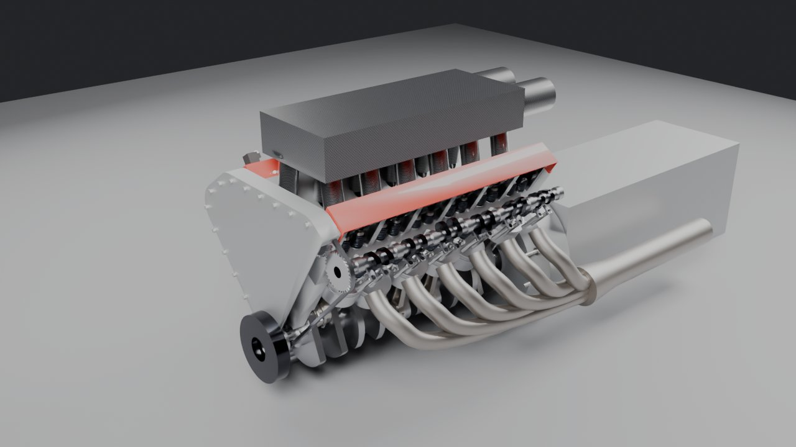
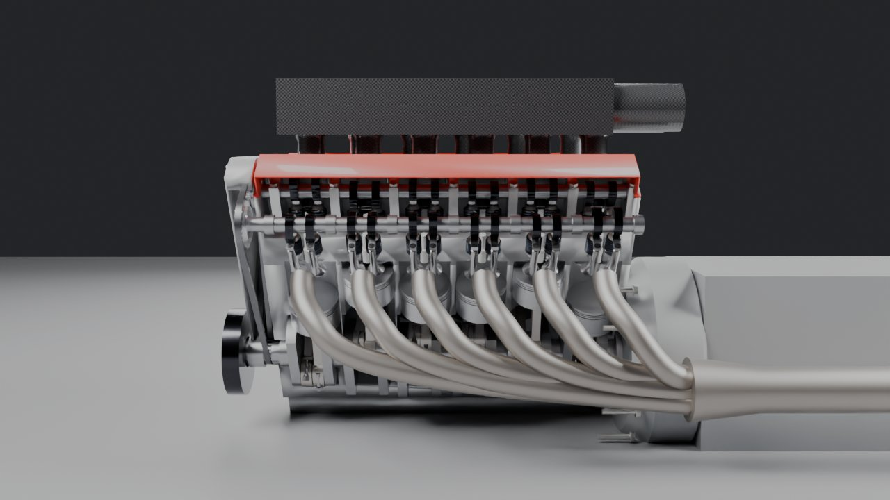

# Ferrari F140HC (Daytona SP3) V12: Blender build

A parametric Blender model of the Daytona SP3's 6.5 L 65° V12, with internals that
actually run. Pistons, rods, crank, four camshafts, 48 valves, 48 finger followers
and 48 valve springs all move correctly against each other.




## Status, honestly

This is a **dimensionally grounded, mechanically correct base**. It is not yet a 1:1
replica of the real engine's appearance. The internals are built on the published
geometry: bore, stroke, bank angle, and a firing order that fits the crank. The
castings are blocked in from estimates: block, heads, cam covers, timing cover,
plenum, exhaust and gearbox. Making them look like the real parts needs reference
images and part diagrams, listed below. Nobody outside Ferrari has the CAD, and that
includes the paid marketplace models. Those are artists working from photos.

| Area | State |
|---|---|
| Crank, rods, pistons | Working slider-crank kinematics, checked to 0.0001 mm |
| Cams, followers, valves, springs | Working. Lobes are cut from the same lift law that drives the valves |
| Firing order | 1-7-5-11-3-9-6-12-2-8-4-10, with 65°/55° alternating intervals |
| Block, heads, cam covers | Simplified castings with real bores, chambers, ports and cam galleries |
| Timing chains | Placeholder routing (static) |
| Intake plenum / SP3 carbon airboxes | Placeholder |
| Exhaust | Placeholder routing |
| Gearbox (7-speed DCT) | Placeholder box |
| Fasteners | 247, counts and positions estimated |

## Run it

**Inside Blender (4.2+ / 5.x):** Scripting tab > Open > `f140hc_build.py` > Run Script.
It builds into an `F140HC` collection, and running it again rebuilds that collection.
Press Space to play. Frames 1–120 are one full four-stroke cycle and loop seamlessly.

**Controls:** select `F140HC_CONTROL` and open Object Properties > Custom Properties.

- `deg_per_frame`: crank speed (6 = 720° in 120 frames)
- `offset_deg`: crank angle, for posing stills
- `cutaway`: 1 cuts bank 7-12, the crankcase and the covers open; 0 closes the engine

All drivers are Blender "simple expressions", so the model runs without enabling
Auto Run Python Scripts.

**Headless / check it:**

```bash
blender -b -P f140hc/verify.py -- --render renders/
```

`verify.py` builds the engine, steps through a full cycle and checks five things.
Every driver must be a simple expression. Rod big-ends must stay on the crankpins.
TDC and BDC heights must be exact. Valve lift must match the cam lobe under the
follower. Valves must never touch the pistons. It exits non-zero on failure.

## The numbers

All dimensions live in the `P` table at the top of `f140hc_build.py`. Change one and
the whole engine re-derives.

**Sourced (Ferrari Daytona SP3 technical sheet):** bore 94.0 mm, stroke 78.0 mm,
6496 cc, 65° V12, 13.6:1 compression, 840 cv at 9250 rpm, 697 Nm at 7250 rpm, 9500
rpm limit. Derived from the 812 Competizione's F140HB, with a new intake and exhaust.

**Sourced (812 Competizione F140HB, same core):** titanium con-rods, 40% lighter than
steel. Steel sliding finger followers with DLC coating. Variable-length intake tracts
with a compact plenum.

**Sourced (SP3 press coverage):** air enters from the rear, turns 180° into carbon
airboxes, then into carbon intake ducts that cover the red cylinder-head covers.

**Estimated:** everything else. That covers rod length, bore pitch, bank offset, deck
height, valve sizes, angles and lift, cam timing, casting dimensions, sprocket teeth
and bolt counts. Each estimate is tagged `EST` in the code. The firing order is the
classic Ferrari V12 pattern and fits this crank geometry, but Ferrari hasn't confirmed
it for the F140.

## Getting to bolt-accurate

In order of value:

1. **Eurospares exploded parts diagrams.** These are free to browse and show every
   part and fastener with Ferrari part numbers and quantities.
   - SP3: [crankcase](https://www.eurospares.co.uk/Ferrari/Daytona_SP3/Daytona_SP3/PartDiagrams/B_01/CRANKCASE), [engine covers](https://www.eurospares.co.uk/Ferrari/Daytona_SP3/Daytona_SP3/PartDiagrams/B_03/ENGINE_COVERS), [all SP3 diagrams](https://www.eurospares.co.uk/ferrari/daytona-sp3)
   - 812 Competizione (F140HB, same family): [LH head](https://www.eurospares.co.uk/Ferrari/812/812_Competizione/PartDiagrams/B_08_02/CYLINDER_HEADS_-_LH_HEAD), [RH head](https://eurospares.co.uk/Ferrari/812/812_Competizione/PartDiagrams/B_08_01/CYLINDER_HEADS_-_RH_HEAD)
   - 812 Superfast: [crank, rods and pistons](https://eurospares.co.uk/Ferrari/812/812_Superfast_(RHD)/PartDiagrams/0002/CRANKSHAFT_-_CONNECTING_RODS_AND_PISTONS), [timing and tappets](https://www.eurospares.co.uk/Ferrari/812/812_Superfast_(RHD)/PartDiagrams/0005/TIMING_SYSTEM_-_TAPPETS)
2. **Amalgam's 1:4 SP3 engine and gearbox** ([product](https://www.amalgamcollection.com/products/ferrari-daytona-sp3-engine-and-gearbox), [press release](https://amalgamcollection.com/blogs/press-releases/amalgam-launches-the-ferrari-daytona-sp3-engine-and-gearbox-1-4-scale-replica), [reveal video](https://motorsport.tv/amalgam-collection/video/revealing-the-ferrari-daytona-sp3-engine-gearbox-14-scale/174011)).
   This is the best photo reference of the complete engine and gearbox. Its quoted
   size (>43 cm long, 21 cm wide, about 18 cm tall at 1:4) is the wireframe
   `F140HC_Amalgam_Envelope_x4` box in the scene.
3. **Ferrari press photos** of the SP3 and the 812 Competizione engine.
4. **Measuring a real engine** or photogrammetry. This is the only route to true 1:1
   internals such as rod length, port shapes and cam profiles.

The wireframe envelope box is wider (840 mm) than this engine currently is (about
600 mm). The replica includes the gearbox and the SP3's exhaust and airbox
packaging, so treat that gap as something to resolve from reference photos, not
proof the engine is too narrow.

## Sources

- [Ferrari F140 engine (Wikipedia)](https://en.wikipedia.org/wiki/Ferrari_F140_engine), [Ferrari Daytona SP3 (Wikipedia)](https://en.wikipedia.org/wiki/Ferrari_Daytona_SP3)
- [Daytona SP3 technical sheet (Ferrari, via autointernational.com.my)](https://autointernational.com.my/WebNews/Overseas/Year%202021/Dec%2021/Ferrari%20new%20%20Icona%20-%205%20Dec%2021/Daytona%20SP3%20-%20The%20new%20Ferrari%20Icona_Specs.pdf)
- [812 Competizione release (Ferrari)](https://corporate.ferrari.com/en/812-competizione-and-812-competizione-two-interpretations-ferraris-racing-soul), [State of Speed](https://stateofspeed.com/2021/05/05/ferrari-competizione-and-competizione-a-leave-no-stone-unturned/)
- [Motor1: Daytona SP3 debut](https://www.motor1.com/news/549238/ferrari-daytona-sp3-icona/), [Forza: Rolling Fantasy](https://www.forza-mag.com/issues/202/articles/rolling-fantasy), [Car and Vintage](https://carandvintage.com/ferrari-daytona-sp3-supercar/)
- [Motor1: Amalgam SP3 engine](https://www.motor1.com/news/653734/ferrari-daytona-sp3-engine-automotive-art-amalgam-scale-replica/), [duPont Registry](https://blog.dupontregistry.com/news/653715/amalgam-ferrari-daytona-sp3-engine/)
- [web-cars.com: Enzo F140 notes (225 kg engine mass, Enzo F140B)](https://www.web-cars.com/enzo/motor.html)
